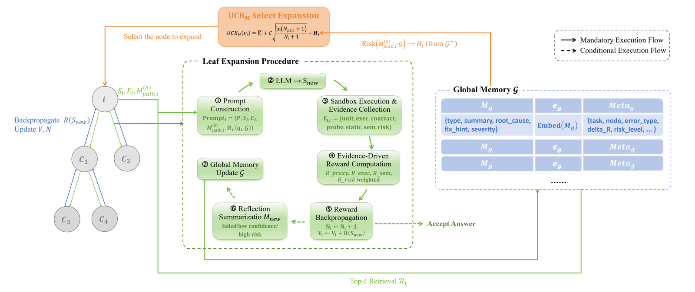
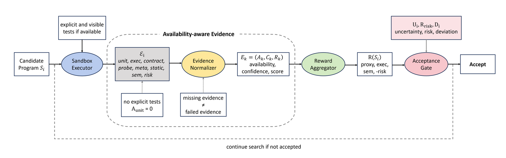

<div align="center">

# ReMCTS: Reflection-Enhanced Monte Carlo Tree Search for Code Generation

**Wang Huifei**<sup>1</sup> · **Huang Xinying**<sup>2</sup> · **Sun Yiheng**<sup>1</sup> · **Yifan Yuan**<sup>2&dagger;</sup>

<sup>1</sup>College of Computer Science and Software Engineering, Shenzhen University
<br>
<sup>2</sup>School of Artificial Intelligence, Shenzhen University
<br>
<sup>&dagger;</sup>Corresponding author

**EMNLP 2026**

<a href="https://arxiv.org/abs/2609.34717"></a>
<a href="pyproject.toml"></a>
<a href="LICENSE"></a>

</div>

<p align="center"><br><em>ReMCTS: selection, expansion, execution, reflection and backpropagation over a tree of candidate programs.</em></p>

**TL;DR:** LLM-written code often looks right but fails on edge cases and hidden tests, and single-trajectory self-repair keeps patching an early wrong idea. **ReMCTS** searches over a tree of candidate programs: every candidate is executed in a sandbox, failures become structured reflections that the branch keeps (*path memory*) and that other branches retrieve (*task-local global memory*), and an availability-aware evidence reward tells failed checks apart from missing evidence, so the search also works when no tests are given. On HumanEval and MBPP-Sanitized, ReMCTS with visible tests beats direct generation in 8 of 10 model–dataset pairs; controlled sampling, repair, tree-search and memory ablations show where the gains come from and where they stop.

## 🔍 Method

Each iteration runs **selection → expansion → execution → reflection → backpropagation**:

| Step | What happens | Code |
|:-|:-|:-|
| Selection | Descend by the memory-augmented UCB score below (Eqs. 3–4) | `core/selector.py` |
| Expansion | Sample `branch_factor` children from a prompt with the task, the current program, its feedback, the last *k* path reflections and the top-*t* retrieved global failures | `core/expander.py`, `llm/prompt_builder.py` |
| Execution | Run each child in a Python or C++17 subprocess and collect unit, execution, contract, probe, metamorphic, static, semantic and risk evidence | `sandbox/`, `evaluation/` |
| Reward and acceptance | `known`: $0.6R_{unit}+0.2R_{exec}+0.2R_{sem}$, accept when all visible tests pass. `no_tests`: availability- and confidence-weighted proxy, execution, semantic and risk evidence plus an acceptance gate penalizing uncertainty, risk and code length (Eqs. 8–16) | `reward/scorer.py` |
| Reflection | For every child that is not accepted, write a structured reflection (error type, root cause, fix hint, severity) into the path memory and the global memory (128-d hashed embeddings, cosine retrieval) | `memory/` |
| Backpropagation | Add the reward to every node on the path | `core/backprop.py` |

```math
\mathrm{UCB}_M(v_i) = \bar{V}_i + C\sqrt{\frac{\ln(N_{p(i)}+1)}{N_i+1}} + \alpha\,\mathrm{Conf}\big(M^{(k)}_{\mathrm{path},i}\big) - \beta\,\mathrm{Risk}\big(M^{(k)}_{\mathrm{path},i}, \mathcal{G}\big)
```

`Conf` rewards low-severity reflections with repair hints and positive reward changes on the path; `Risk` is the highest similarity to high-severity failures in the global memory ($C=1.4$, $\alpha=0.4$, $\beta=0.6$).

<p align="center"><br><em>Availability-aware evidence: without explicit tests the unit-test item is unavailable, not failed.</em></p>

## 🛠️ Installation

```bash
git clone https://github.com/MUSE-AI-Lab/ReMCTS.git
cd ReMCTS
python -m venv .venv && source .venv/bin/activate      # Windows: .venv\Scripts\activate
pip install -e ".[dev]"
pytest -q
```

Python 3.10+ is enough; models are called through any OpenAI-compatible Chat Completions API, so no GPU is needed. The HumanEval-X C++ pilot additionally needs `g++` with C++17.

> [!WARNING]
> ReMCTS executes model-generated code. The executors add timeouts and process isolation, but they are not a security sandbox. Run experiments in a container or VM without secrets, network access or valuable writable files.

## 🚀 Quick Start

Offline smoke test (the mock client emits placeholder code, so this checks the pipeline, not accuracy):

```bash
remcts-run-search --config default --task-id smoke \
    --prompt "Write a Python function solution(x) that returns x." --tests "assert solution(1) == 1"
```

With an LLM API (the packaged configs use Qwen3-8B on DashScope; omit `--tests` for the `no_tests` setting):

```bash
export REMCTS_API_KEY="sk-..."
remcts-run-search --config remcts_no_tests --task-id mex --entry-point solution \
    --prompt "Write a Python function solution(nums) that returns the smallest non-negative integer not in nums."
```

<details>
<summary><b>Python API</b></summary>

```python
from remcts.config import load_config
from remcts.core.search_engine import SearchEngine
from remcts.core.state import ProblemSpec

config = load_config("remcts_known")        # packaged name or path to your YAML
config.llm_model_name = "qwen3-32b"
result = SearchEngine(config).run(
    ProblemSpec(task_id="demo", prompt="Return the input unchanged.", entry_point="solution",
                tests="assert solution(1) == 1")
)
print(result.best_code, result.accepted, result.stop_reason)
```
</details>

Every search writes `outputs/runs/<task>-<time>/` with the effective `config.json`, the tree (`nodes.jsonl`), the reflections (`memory.jsonl`) and `summary.json` (including token usage). Another provider only needs `llm.model_name` and `llm.base_url` in a YAML config; see [docs/CONFIGURATION.md](docs/CONFIGURATION.md).

## 📦 Data

```bash
python scripts/prepare_datasets.py
```

downloads HumanEval, MBPP / MBPP-Sanitized, EvalPlus and HumanEval-X C++ from the official sources and derives the splits under `data/` (not tracked by Git). File hashes, sizes and row counts are recorded in [`data/dataset_manifest.json`](data/dataset_manifest.json). The experiment drivers use:

| Dataset | Search input | Hidden evaluation |
|:-|:-|:-|
| `humaneval_full_known` | `humaneval/HumanEval.jsonl` | `humaneval/HumanEval_eval.jsonl` |
| `humaneval_full_no_tests` | `humaneval/HumanEval_no_tests.jsonl` | `humaneval/HumanEval_eval.jsonl` |
| `mbpp_sanitized_full_known` | `mbpp/mbpp_sanitized.json` | `mbpp/mbpp_sanitized_eval_split.json` |
| `mbpp_sanitized_full_no_tests` | `mbpp/mbpp_sanitized_no_tests.json` | `mbpp/mbpp_sanitized_eval_split.json` |
| `humanevalx_cpp` | `humaneval_x/humaneval_cpp_feedback.jsonl` (`example_test`) | `humaneval_x/humaneval_cpp_eval.jsonl` (official `test`) |

## 🧪 Reproducing the Paper

Put provider-labelled keys in a local `apikeys.txt` (ignored by Git); tasks are spread over the keys and move to the next key after a rate-limit or timeout error:

```text
qwen: sk-...
deepseek: sk-...
```

Then check the plan and the estimated cost before calling any API:

```bash
remcts-experiment main --dry-run
```

| Paper | Command |
|:-|:-|
| Table 1: Direct vs. ReMCTS (`known`, `no_tests`) | `remcts-experiment main --report-dir outputs/reports/main` |
| Tables 11–12: Best-of-8, Reflexion-style, Reflection-style, pure-MCTS, MCTS-style | `remcts-experiment baselines --report-dir outputs/reports/baselines` |
| Table 2: Best-of-32 and Reflexion-16 | `remcts-experiment baselines --methods best_of_n reflexion --best-of-n 32 --reflexion-trials 16 --models qwen3-8b qwen3-32b --datasets mbpp_sanitized_full_no_tests` |
| Tables 3, 16: memory ablations | `remcts-experiment ablations --report-dir outputs/reports/ablations` |
| Table 7: HumanEval-X C++ pilot | `remcts-experiment main --datasets humanevalx_cpp --limit 30` |

All commands share `--models`, `--datasets`, `--workers`, `--limit`, `--budget-cny` (stop when the estimated spend reaches the budget) and `--report-dir`. A report directory holds one `<label>.json` per run (per-task rows with the returned code, hidden-test results and token usage), `summary.md` / `summary.json`, and the search traces under `runs/`. Interrupted runs resume from `<label>.progress.json` when the same `--report-dir` is passed again; `remcts-experiment status <report-dir>` shows the progress. Details are in [docs/REPRODUCIBILITY.md](docs/REPRODUCIBILITY.md).

## 📊 Results

Hidden solve rates (%) reported in the paper (Table 1); numbers in parentheses are differences to Direct `no_tests`.

| Model | Dataset | Direct `no_tests` | ReMCTS `no_tests` | ReMCTS `known` |
|:-|:-|:-:|:-:|:-:|
| Qwen3-1.7B | HumanEval | 60.37 | 69.51 (+9.14) | 83.54 (+23.17) |
| | MBPP | 53.40 | 51.29 (−2.11) | 63.47 (+10.07) |
| Qwen3-8B | HumanEval | 79.88 | 86.59 (+6.71) | 93.90 (+14.02) |
| | MBPP | 64.17 | 66.74 (+2.57) | 74.24 (+10.07) |
| Qwen3-14B | HumanEval | 82.93 | 78.66 (−4.27) | 82.93 (+0.00) |
| | MBPP | 66.98 | 60.42 (−6.56) | 65.57 (−1.41) |
| Qwen3-32B | HumanEval | 89.63 | 89.63 (+0.00) | 95.12 (+5.49) |
| | MBPP | 71.90 | 70.49 (−1.41) | 77.99 (+6.09) |
| DeepSeek-V4-Flash | HumanEval | 80.49 | 95.12 (+14.63) | 98.78 (+18.29) |
| | MBPP | 72.60 | 72.83 (+0.23) | 81.03 (+8.43) |

`known` is a test-guided mechanism validation and is not equivalent to standard pass@1. Hosted models change over time, so reruns can deviate; every report records the model alias, date, configuration and token usage.

## 📁 Repository Structure

```text
src/remcts/
├── core/          # search tree, memory-augmented UCB selection, expansion, stopping rules, search loop
├── memory/        # structured reflections, path memory, task-local global memory
├── reward/        # unit / execution / semantic / risk scores and the no_tests acceptance gate
├── evaluation/    # contract checks, probes, metamorphic properties
├── sandbox/       # Python and C++17 executors
├── llm/           # OpenAI-compatible client, credential files, prompts, response parsing
├── experiments/   # paper experiments: datasets, baselines, ablations, runner, reports (remcts-experiment)
├── config/        # YAML configs of ReMCTS and the tree-search baselines
├── tasks/         # HumanEval / MBPP loaders
├── cli/           # remcts-run-search, remcts-evaluate, remcts-inspect-run
└── storage/ · utils/
scripts/prepare_datasets.py   # benchmark download and split derivation
docs/                         # configuration, reproducibility, data policy
tests/
```

## 📝 Citation

```bibtex
@inproceedings{wang2026remcts,
  title         = {{ReMCTS}: Reflection-Enhanced Monte Carlo Tree Search for Code Generation},
  author        = {Wang, Huifei and Huang, Xinying and Sun, Yiheng and Yuan, Yifan},
  booktitle     = {Proceedings of the 2026 Conference on Empirical Methods in Natural Language Processing},
  year          = {2026},
  eprint        = {2609.34717},
  archivePrefix = {arXiv}
}
```

## 📄 License

[MIT](LICENSE). Benchmarks and models keep their own licenses and terms.
