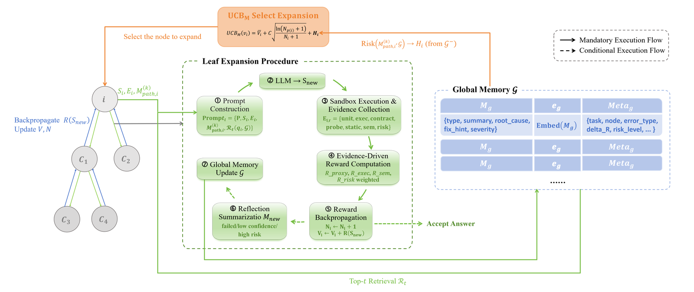
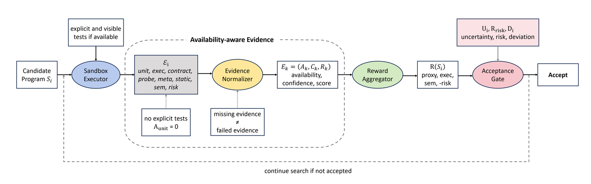

<div align="center">

# ReMCTS: Reflect-Enhanced Monte Carlo Tree Search Strategy for Code Generation

**Wang Huifei**<sup>1</sup> · **Huang Xinying**<sup>2</sup> · **Sun Yiheng**<sup>1</sup> · **Yifan Yuan**<sup>2&dagger;</sup>

<sup>1</sup>College of Computer Science and Software Engineering, Shenzhen University
<br>
<sup>2</sup>School of Artificial Intelligence, Shenzhen University
<br>
<sup>&dagger;</sup>通讯作者

**EMNLP 2026**

<a href="https://arxiv.org/abs/2609.34717"></a>
<a href="https://aclanthology.org/2026.findings-emnlp.293/"></a>
<a href="pyproject.toml"></a>
<a href="LICENSE"></a>

[English](README.md) · [简体中文](README_zh.md)

</div>

<p align="center"><br><em>ReMCTS：在候选程序树上依次进行选择、扩展、执行、反思与反向传播。</em></p>

**一句话总结：** 大模型写出的代码常常看似正确，却在边界情况和隐藏测试上出错；而单轨迹的自我修复只会在早期的错误思路上反复打补丁。**ReMCTS** 在候选程序树上进行搜索：每个候选程序都在沙箱中执行，失败会被整理成结构化反思，既由所在分支保留（*路径记忆*），也可供其他分支检索（*任务内全局记忆*）；可用性感知的证据奖励能够区分“检查未通过”与“缺少证据”，因此在不提供测试时搜索同样有效。在 HumanEval 和 MBPP-Sanitized 上，使用可见测试的 ReMCTS 在 10 个模型—数据集组合中的 8 个上优于直接生成；针对采样、修复、树搜索和记忆的受控消融实验则揭示了性能提升从何而来、又在何处止步。

## 🔍 方法

每次迭代依次执行**选择 → 扩展 → 执行 → 反思 → 反向传播**：

| 步骤 | 内容 | 代码 |
|:-|:-|:-|
| 选择 | 按下式的记忆增强 UCB 分数自根向下选择节点（式 3–4） | `core/selector.py` |
| 扩展 | 以包含任务描述、当前程序及其反馈、最近 *k* 条路径反思和检索到的前 *t* 条全局失败记录的提示词，采样 `branch_factor` 个子节点 | `core/expander.py`、`llm/prompt_builder.py` |
| 执行 | 在 Python 或 C++17 子进程中运行每个子节点，收集单元测试、执行、契约、探针、蜕变关系、静态检查、语义和风险等各类证据 | `sandbox/`、`evaluation/` |
| 奖励与接受 | `known`：$0.6R_{unit}+0.2R_{exec}+0.2R_{sem}$，所有可见测试通过即接受。`no_tests`：按可用性和置信度加权的代理、执行、语义和风险证据，外加一个对不确定性、风险和代码长度施加惩罚的接受门控（式 8–16） | `reward/scorer.py` |
| 反思 | 对每个未被接受的子节点生成一条结构化反思（错误类型、根本原因、修复提示、严重程度），写入路径记忆和全局记忆（128 维哈希嵌入，余弦相似度检索） | `memory/` |
| 反向传播 | 将奖励累加到路径上的每个节点 | `core/backprop.py` |

```math
\mathrm{UCB}_M(v_i) = \bar{V}_i + C\sqrt{\frac{\ln(N_{p(i)}+1)}{N_i+1}} + \alpha\,\mathrm{Conf}\big(M^{(k)}_{\mathrm{path},i}\big) - \beta\,\mathrm{Risk}\big(M^{(k)}_{\mathrm{path},i}, \mathcal{G}\big)
```

`Conf` 项对路径上严重程度低、附带修复提示的反思以及正向的奖励变化给予加分；`Risk` 项取与全局记忆中高严重程度失败的最高相似度（$C=1.4$，$\alpha=0.4$，$\beta=0.6$）。

<p align="center"><br><em>可用性感知的证据：没有显式测试时，单元测试项记为“不可用”，而非“未通过”。</em></p>

## 🛠️ 安装

```bash
git clone https://github.com/MUSE-AI-Lab/ReMCTS.git
cd ReMCTS
python -m venv .venv && source .venv/bin/activate      # Windows 下：.venv\Scripts\activate
pip install -e ".[dev]"
pytest -q
```

只需 Python 3.10+；模型通过任意兼容 OpenAI 的 Chat Completions API 调用，因此不需要 GPU。HumanEval-X C++ 试点实验还需要支持 C++17 的 `g++`。

> [!WARNING]
> ReMCTS 会执行模型生成的代码。执行器提供了超时和进程隔离，但并不是安全沙箱。请在不含密钥、无法联网、也没有重要可写文件的容器或虚拟机中运行实验。

## 🚀 快速开始

离线冒烟测试（模拟客户端只会输出占位代码，因此这里只检查流水线能否跑通，不反映准确率）：

```bash
remcts-run-search --config default --task-id smoke \
    --prompt "Write a Python function solution(x) that returns x." --tests "assert solution(1) == 1"
```

接入大模型 API（内置配置使用 DashScope 上的 Qwen3-8B；省略 `--tests` 即为 `no_tests` 设置）：

```bash
export REMCTS_API_KEY="sk-..."
remcts-run-search --config remcts_no_tests --task-id mex --entry-point solution \
    --prompt "Write a Python function solution(nums) that returns the smallest non-negative integer not in nums."
```

<details>
<summary><b>Python API</b></summary>

```python
from remcts.config import load_config
from remcts.core.search_engine import SearchEngine
from remcts.core.state import ProblemSpec

config = load_config("remcts_known")        # 内置配置名，或你自己的 YAML 文件路径
config.llm_model_name = "qwen3-32b"
result = SearchEngine(config).run(
    ProblemSpec(task_id="demo", prompt="Return the input unchanged.", entry_point="solution",
                tests="assert solution(1) == 1")
)
print(result.best_code, result.accepted, result.stop_reason)
```
</details>

每次搜索都会写入 `outputs/runs/<task>-<time>/`，其中包含实际生效的 `config.json`、搜索树（`nodes.jsonl`）、反思记录（`memory.jsonl`）以及 `summary.json`（含 token 用量）。换用其他模型服务商时，只需在 YAML 配置中设置 `llm.model_name` 和 `llm.base_url`，详见 [docs/CONFIGURATION.md](docs/CONFIGURATION.md)。

## 📦 数据

```bash
python scripts/prepare_datasets.py
```

上述命令会从官方来源下载 HumanEval、MBPP / MBPP-Sanitized、EvalPlus 和 HumanEval-X C++，并在 `data/` 下生成数据划分（该目录不受 Git 跟踪）。文件哈希、大小和行数记录在 [`data/dataset_manifest.json`](data/dataset_manifest.json) 中。各实验驱动脚本使用的数据如下：

| 数据集 | 搜索输入 | 隐藏评测 |
|:-|:-|:-|
| `humaneval_full_known` | `humaneval/HumanEval.jsonl` | `humaneval/HumanEval_eval.jsonl` |
| `humaneval_full_no_tests` | `humaneval/HumanEval_no_tests.jsonl` | `humaneval/HumanEval_eval.jsonl` |
| `mbpp_sanitized_full_known` | `mbpp/mbpp_sanitized.json` | `mbpp/mbpp_sanitized_eval_split.json` |
| `mbpp_sanitized_full_no_tests` | `mbpp/mbpp_sanitized_no_tests.json` | `mbpp/mbpp_sanitized_eval_split.json` |
| `humanevalx_cpp` | `humaneval_x/humaneval_cpp_feedback.jsonl`（`example_test`） | `humaneval_x/humaneval_cpp_eval.jsonl`（官方 `test`） |

## 🧪 复现论文结果

将标注了服务商的密钥写入本地 `apikeys.txt`（已被 Git 忽略）；任务会分摊到各个密钥上，遇到限流或超时错误时自动切换到下一个密钥：

```text
qwen: sk-...
deepseek: sk-...
```

然后，在调用任何 API 之前，先检查实验计划和预估费用：

```bash
remcts-experiment main --dry-run
```

| 论文 | 命令 |
|:-|:-|
| 表 1：Direct 与 ReMCTS 对比（`known`、`no_tests`） | `remcts-experiment main --report-dir outputs/reports/main` |
| 表 11–12：Best-of-8、Reflexion-style、Reflection-style、pure-MCTS、MCTS-style | `remcts-experiment baselines --report-dir outputs/reports/baselines` |
| 表 2：Best-of-32 与 Reflexion-16 | `remcts-experiment baselines --methods best_of_n reflexion --best-of-n 32 --reflexion-trials 16 --models qwen3-8b qwen3-32b --datasets mbpp_sanitized_full_no_tests` |
| 表 3、16：记忆消融 | `remcts-experiment ablations --report-dir outputs/reports/ablations` |
| 表 7：HumanEval-X C++ 试点实验 | `remcts-experiment main --datasets humanevalx_cpp --limit 30` |

所有命令都支持 `--models`、`--datasets`、`--workers`、`--limit`、`--budget-cny`（预估花费达到预算时停止）和 `--report-dir`。报告目录中，每次运行对应一个 `<label>.json`（逐任务记录返回的代码、隐藏测试结果和 token 用量），此外还有 `summary.md` / `summary.json`，以及 `runs/` 下的搜索轨迹。中断的运行在再次传入同一 `--report-dir` 时会从 `<label>.progress.json` 续跑；`remcts-experiment status <report-dir>` 可查看进度。详见 [docs/REPRODUCIBILITY.md](docs/REPRODUCIBILITY.md)。

## 📊 实验结果

隐藏测试求解率（%），数据取自论文表 1；括号内为相对 Direct `no_tests` 的差值。

| 模型 | 数据集 | Direct `no_tests` | ReMCTS `no_tests` | ReMCTS `known` |
|:-|:-|:-:|:-:|:-:|
| Qwen3-1.7B | HumanEval | 60.37 | 69.51 (+9.14) | 83.54 (+23.17) |
| | MBPP | 53.40 | 51.29 (−2.11) | 63.47 (+10.07) |
| Qwen3-8B | HumanEval | 79.88 | 86.59 (+6.71) | 93.90 (+14.02) |
| | MBPP | 64.17 | 66.74 (+2.57) | 74.24 (+10.07) |
| Qwen3-14B | HumanEval | 82.93 | 78.66 (−4.27) | 82.93 (+0.00) |
| | MBPP | 66.98 | 60.42 (−6.56) | 65.57 (−1.41) |
| Qwen3-32B | HumanEval | 89.63 | 89.63 (+0.00) | 95.12 (+5.49) |
| | MBPP | 71.90 | 70.49 (−1.41) | 77.99 (+6.09) |
| DeepSeek-V4-Flash | HumanEval | 80.49 | 95.12 (+14.63) | 98.78 (+18.29) |
| | MBPP | 72.60 | 72.83 (+0.23) | 81.03 (+8.43) |

`known` 设置是借助测试引导的机制验证，并不等同于标准的 pass@1。托管模型会随时间变化，因此重新运行的结果可能有所偏差；每份报告都记录了模型别名、日期、配置和 token 用量。

## 📁 仓库结构

```text
src/remcts/
├── core/          # 搜索树、记忆增强的 UCB 选择、扩展、停止规则与搜索主循环
├── memory/        # 结构化反思、路径记忆与任务内全局记忆
├── reward/        # 单元测试 / 执行 / 语义 / 风险评分，以及 no_tests 设置下的接受门控
├── evaluation/    # 契约检查、探针与蜕变关系
├── sandbox/       # Python 与 C++17 执行器
├── llm/           # 兼容 OpenAI 接口的客户端、凭据文件、提示词与响应解析
├── experiments/   # 论文实验：数据集、基线、消融、运行器与报告（remcts-experiment）
├── config/        # ReMCTS 及树搜索基线的 YAML 配置
├── tasks/         # HumanEval / MBPP 数据加载
├── cli/           # 命令行工具：remcts-run-search、remcts-evaluate、remcts-inspect-run
└── storage/ · utils/
scripts/prepare_datasets.py   # 下载基准数据并生成数据划分
docs/                         # 配置、可复现性与数据政策文档
tests/
```

## 📝 引用

```bibtex
@inproceedings{huifei-etal-2026-remcts,
    title = "{R}e{MCTS}: Reflect-Enhanced {M}onte {C}arlo Tree Search Strategy for Code Generation",
    author = "Huifei, Wang  and
      Xinying, Huang  and
      Yiheng, Sun  and
      Yuan, Yifan",
    editor = "Lee, Hung-Yi  and
      Dev, Sunipa  and
      Li, Jessy  and
      Elliott, Desmond",
    booktitle = "Findings of the {A}ssociation for {C}omputational {L}inguistics: {EMNLP} 2026",
    month = oct,
    year = "2026",
    address = "Budapest, Hungary",
    publisher = "Association for Computational Linguistics",
    url = "https://aclanthology.org/2026.findings-emnlp.293/",
    doi = "10.18653/2026.findings-emnlp.293",
    pages = "6227--6247",
    ISBN = "979-8-89176-462-0"
}
```

## 📄 许可证

[MIT](LICENSE)。基准数据集和模型仍受各自的许可与条款约束。
